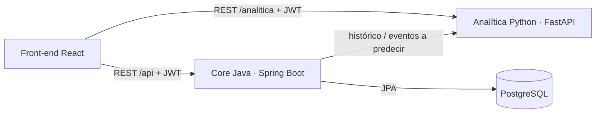

# Sistema de gestión de eventos universitarios con predicción de asistencia

Proyecto integrador · Programación de Vanguardia (2026)

Una plataforma única para **crear y publicar eventos**, **inscribirse**, **registrar asistencia (lista, código o QR)** y **estimar cuánta gente va a ir**. Sirve para asignar bien las salas y tomar decisiones con datos históricos.

## Arquitectura

| Componente | Tecnología | Puerto | Carpeta |
|---|---|---|---|
| Front-end | React 18 + Vite + Recharts (servido por nginx) | 3000 | `frontend/` |
| Microservicio 1: core del negocio | Java 21 + Spring Boot 3.3 + Spring Security (JWT) + JPA | 8080 | `core-java/` |
| Microservicio 2: analítica predictiva | Python 3.12 + FastAPI + scikit-learn | 8000 | `analitica-python/` |
| Base de datos | PostgreSQL 16 | 5432 | `db/init/` |



El front-end habla con los **dos** microservicios. Con el core Java hace el login, los eventos, las inscripciones, la asistencia y el panel. Con el servicio Python pide las tendencias y las métricas del modelo. El core le manda al servicio Python los datos históricos para entrenar y los eventos a predecir, y guarda cada predicción en la tabla `predicciones`. Los tres componentes validan el mismo JWT (secreto HMAC compartido).

## Cómo ejecutarlo

### Opción A: Docker (recomendada)

```bash
docker compose up --build
```

Después abrí **http://localhost:3000**.

- La primera vez PostgreSQL crea el esquema y carga los datos de demo: unos 140 eventos finalizados en los últimos 18 meses, 16 eventos próximos y 420 usuarios.
- Al arrancar, el core Java entrena el modelo automáticamente.
- Swagger del core: http://localhost:8080/swagger-ui.html
- Swagger de la analítica: http://localhost:8000/docs

Para volver a cargar los datos de demo desde cero: `docker compose down -v && docker compose up --build`.

### Opción B: cada servicio por separado (desarrollo)

```bash
# 1) Base de datos: crear la BD "eventos" (usuario/clave eventos) y ejecutar los scripts
psql -U eventos -d eventos -f db/init/01_esquema.sql -f db/init/02_datos_demo.sql

# 2) Analítica (Python)
cd analitica-python && python -m venv .venv && source .venv/bin/activate
pip install -r requirements.txt && uvicorn app.main:app --port 8000

# 3) Core (Java 21 + Maven)
cd core-java && mvn spring-boot:run

# 4) Front-end
cd frontend && npm install && npm run dev      # http://localhost:5173
```

## Generar datos de uso real (simulador)

Con el sistema levantado, en otra terminal:

```bash
docker compose run --rm simulador
```

El simulador usa la API como lo harían las personas:

1. Registra usuarios nuevos y el administrador da de alta una sala.
2. Los organizadores crean y publican eventos próximos, con aciertos y errores al elegir sala.
3. Estudiantes, docentes y personal se inscriben, y algunos cancelan.
4. En los eventos de hoy, apoyo@ registra la asistencia por QR, código o lista y los eventos se finalizan.
5. Se reentrena el modelo y se generan las predicciones.

Opciones:
- `--futuros 20 --hoy 6 --nuevos 40`: cambiar las cantidades.
- `--llenar <id> --cantidad 50`: solo suma inscriptos a un evento.
- `--cierres 3`: solo emula el cierre de 3 eventos de hoy (asistencia, finalización y encuestas) y reentrena el modelo. `--tasa-respuesta 0.7` cambia cuántos asistentes responden; `estudiante@` asiste pero deja su encuesta pendiente para responderla en vivo (`--pendiente ""` lo desactiva).

Para pasarlas: `docker compose run --rm simulador python /tools/simular_uso.py --api http://core:8080 <opciones>`.

La guía completa de uso está en `docs/Guia_de_uso_y_demostracion.docx`.

## Usuarios de prueba

La contraseña de todos es `demo1234`. En la pantalla de login hay botones para completarlos.

| Rol | Email | Qué puede hacer |
|---|---|---|
| Administrador | admin@uni.edu.ar | Todo, más salas, usuarios y roles |
| Organizador | organizador@uni.edu.ar | Crear, editar y publicar sus eventos, panel, predicciones y asistencia |
| Personal de apoyo | apoyo@uni.edu.ar | Registrar asistencia y ver estadísticas |
| Estudiante | estudiante@uni.edu.ar | Ver eventos, inscribirse y mostrar su QR |

## Casos de uso cubiertos

1. **Gestión de eventos (CRUD):** alta, edición, baja, publicación, finalización y cancelación. Controla que dos eventos no ocupen la misma sala en horarios superpuestos.
2. **Inscripción:** listado con filtros por fecha, tipo, facultad y texto. La inscripción genera un código único que el usuario ve como QR. Se valida el cupo.
3. **Registro de asistencia:** por lista (checkbox), código tipeado o **QR escaneado con la cámara**. Es idempotente.
4. **Panel del organizador:** muestra inscriptos, asistentes, estado, historial, indicadores, estadísticas por evento y acceso a las predicciones.
5. **Encuesta de satisfacción:** al finalizar un evento, cada asistente ve en la app (aviso + sección *Encuestas*) una encuesta de 1 a 5 estrellas, si lo recomendaría y un comentario opcional. Queda abierta 30 días y se responde una sola vez. El organizador ve los resultados en las estadísticas del evento y el dashboard muestra la satisfacción por tipo, facultad u organizador.
6. **Módulo predictivo (Python):** calcula la asistencia estimada con un intervalo del 80 %, la probabilidad de sobrecapacidad y la de baja asistencia, recomienda sala según el aforo y muestra tendencias por tipo y por facultad con pronóstico.

## Módulo predictivo (resumen)

- **Datos:** un registro por evento finalizado (vista `v_historico_eventos`): tipo, facultad, fecha, horario, duración, clima, aforo, inscriptos y asistentes.
- **Modelo de inscriptos (Random Forest):** proyecta los inscriptos al cierre de la inscripción cuando el evento todavía está lejos.
- **Modelo de tasa de asistencia:** se comparan una **regresión Ridge** y un **Random Forest** con validación cruzada de 5 folds, y se queda el de menor error medio absoluto. También se reporta una línea base (promedio por tipo).
- **Incertidumbre:** se usa una aproximación normal con el error de validación cruzada más la dispersión entre árboles. Con eso se calculan el intervalo del 80 %, `P(asistentes > aforo)` y `P(asistentes < 40 % del aforo)`.
- **Retroalimentación con encuestas:** cada evento lleva como variable la *satisfacción previa* de su organizador (puntaje medio de sus eventos anteriores, suavizado hacia el promedio general). Sólo se usan eventos con fecha anterior, para no "espiar" el resultado. Con los datos de demo, el error medio baja de ~4,5 a ~4,3 personas y el error en la tasa de asistencia cae un 8 %.
- **Sala recomendada:** la más chica, de la facultad o de uso general, que cubra el escenario alto (percentil 90).
- **Series temporales:** media móvil de 3 meses por grupo y pronóstico a 3 meses con suavizado exponencial de **Holt**.

## Actualizar una base existente (encuestas)

Si ya tenías el sistema levantado de antes, hay dos opciones:

- **Recrear la base con los datos de demo nuevos (incluyen 3.000 respuestas de encuestas):** `docker compose down -v && docker compose up --build -d`
- **Conservar tus datos:** aplicar la migración y reconstruir:
  - cmd: `docker compose exec -T db psql -U eventos -d eventos < db\migraciones\2026-10_encuestas.sql`
  - PowerShell: `Get-Content db\migraciones\2026-10_encuestas.sql | docker compose exec -T db psql -U eventos -d eventos`
  - y después `docker compose up --build -d`

## Pruebas

```bash
cd analitica-python && pytest -q        # 10 pruebas: seguridad, predicción, lluvia, sala, lote, tendencias, encuestas
cd core-java && mvn test                # pruebas de JwtService
```

## Estructura

```
db/init/             01_esquema.sql (8 tablas + vista) · 02_datos_demo.sql (generado)
db/migraciones/      scripts para actualizar bases ya creadas
tools/               generar_datos_demo.py (regenera los datos de demo)
core-java/           Spring Boot: domain, repository, service, web, security, dto, exception
analitica-python/    FastAPI: modelo.py, tendencias.py, main.py, seguridad.py, tests/
frontend/            React: pages/, components/, api.js, auth.jsx
docs/                documentación, diagramas (Mermaid) y capturas de pantalla
```
